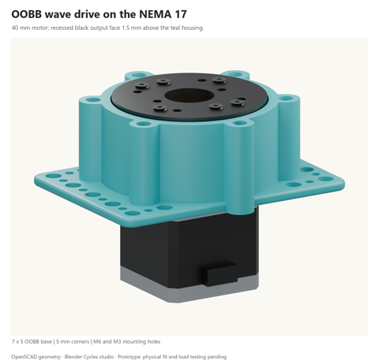

# Wave drive

A 3D-printable roller wave gearbox for a NEMA 17 motor, with OOBB mounting holes on the base and output face. An eccentric wheel drives a cage through a ring of nylon rollers. This repository includes editable Python/OpenSCAD source, printable files and illustrated assembly instructions.

Inspired by [Mishin Machine](https://www.youtube.com/@MishinMachine) and their video [Wave Drive with Rolling Elements — Cycloidal Gear Alternative!](https://www.youtube.com/watch?v=zOLQw-TxE7s).

This is an entirely AI-generated coding project. The source code is largely unreadable by humans, but usable generated files are included. It is published so others can use their own AI tools to understand, modify and regenerate the design. Physical fit, wear, speed and load capacity have not been tested.

> AI-generated CAD images and instructions. Errors possible.

## Versions

Open **HTML assembly instructions** to view the full-screen steps directly in your browser. Use **PDF download** for the printable booklet.

| Image | Version and description | Main README | HTML assembly instructions | PDF download |
| --- | --- | --- | --- | --- |
|  | **12:1 / NEMA 17** Single roller bank; twelve 7 mm OD × 12 mm spacers; 6810 output bearing and 6704 wave bearing; 7 × 5 OOBB base. Includes optional printable spacers. | [README](README_DETAILS.md) | [Open in browser](https://oomlout.github.io/oomlout_oobb_part_motor_gearbox_wave_drive_version_5/) | [Download PDF](https://github.com/oomlout/oomlout_oobb_part_motor_gearbox_wave_drive_version_5/raw/refs/heads/main/parts/oobb_part_motor_gearbox_wave_drive_version_5_12_to_1_reduction/assembly/assembly_instructions.pdf) |
