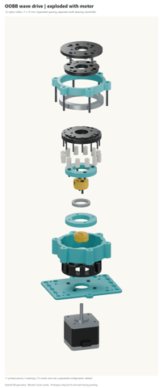

# Wave drive - 12:1 reduction / NEMA 17

**[Open the full-screen assembly instructions](https://oomlout.github.io/oomlout_oobb_part_motor_gearbox_wave_drive_version_5/)**

[PDF booklet](parts/oobb_part_motor_gearbox_wave_drive_version_5_12_to_1_reduction/assembly/assembly_instructions.pdf) · [Download the standalone HTML](https://github.com/oomlout/oomlout_oobb_part_motor_gearbox_wave_drive_version_5/raw/refs/heads/main/parts/oobb_part_motor_gearbox_wave_drive_version_5_12_to_1_reduction/assembly/assembly_instructions.html) · [Full details and written instructions](README_DETAILS.md)

> AI-generated CAD images and instructions. Errors possible.

## Summary

A 3D-printable 12:1 roller wave gearbox for a NEMA 17 motor, with an OOBB mounting base and output face. Twelve nylon spacers transfer motion from an eccentric wheel to the output cage. The output turns once in the opposite direction for every 12 motor turns.

This is an entirely AI-generated coding project. Generated outputs are included and generally run, but the main purpose of publishing is to provide a starting point for modification with your own AI tools. Physical fit, wear, speed and load capacity have not been tested.

## Details

The gearbox uses one 6810 output bearing, one 6704 wave bearing and a 40 mm NEMA 17 body. Its centred 7 x 5 OOBB base has M6 grid holes and M3 half-grid holes. The output face carries captive M6 and M3 nuts.

[Printable files and SCAD source](parts/oobb_part_motor_gearbox_wave_drive_version_5_12_to_1_reduction/) · [Dimensions, regeneration and assembly](README_DETAILS.md)

## Parts

Print the 11 gearbox parts. The combined `3dpr` file and print-bed layouts also contain 12 optional spacers: 7 mm OD x 12 mm depth, 3.2 mm bore. Use these **or** purchased nylon spacers. Do not fit both sets.

[Boxed parts list](https://oomlout.github.io/oomlout_oobb_part_motor_gearbox_wave_drive_version_5/#parts) · [Hardware quantities and print options](README_DETAILS.md#hardware)

## Assembly

[Start at step 1](https://oomlout.github.io/oomlout_oobb_part_motor_gearbox_wave_drive_version_5/#step-01). Each screen shows one step and the parts needed. Use the arrow keys, swipe or the step selector; choose **Full screen** for the largest view. The downloaded HTML works offline with all images included.

For paper instructions, use the [eight-page A4 landscape PDF](parts/oobb_part_motor_gearbox_wave_drive_version_5_12_to_1_reduction/assembly/assembly_instructions.pdf). For preparation, screw lengths, shaft-clamp access and the complete written sequence, use the [detailed README](README_DETAILS.md#assembly-instructions).
