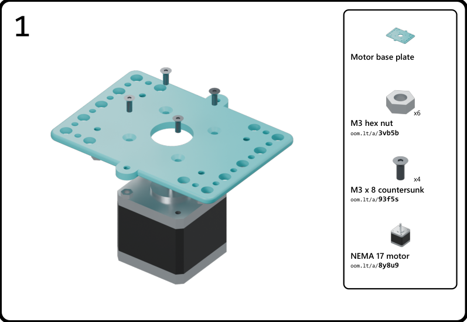
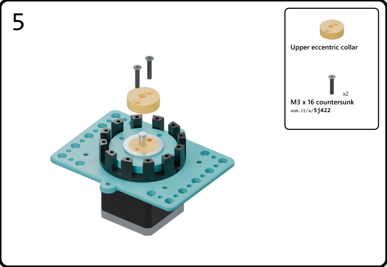

# Wave drive - design and assembly

[Full-screen HTML instructions](https://oomlout.github.io/oomlout_oobb_part_motor_gearbox_wave_drive_version_5/) · [PDF booklet](parts/oobb_part_motor_gearbox_wave_drive_version_5_12_to_1_reduction/assembly/assembly_instructions.pdf) · [Project overview](README.md)

## Regenerate

Edit `working_oomp_populate.py`. The standard build runs `working_oomp_populate` -> `working_oomp` -> `working_scad`, then generates the drawings, meshes, Blender renders, PDF, standalone HTML and these READMEs. No AI session is needed to rebuild.

```powershell
python working.py
python working.py --scad-only     # editable drawings without mesh export
python working.py --no-renders    # meshes and checks without Blender
python working.py --assembly-only # instructions from validated meshes
python -m pytest -q
```

Python regeneration needs the installed OOBB/OOMP packages, `requirements.txt`, OpenSCAD with its Manifold backend and Blender on PATH. Generated SCAD is portable. Use `get_options()` for named configurations; all configuration-specific output stays inside its `parts/<part-id>/` folder.

The published HTML is served from this repository's `gh-pages` branch. `components/wave_drive/publish_github.py` republishes the generated viewer and PDF; it does not regenerate CAD.

## Design details

One bank of 12 nylon spacers, 7 mm OD x 12 mm long. Output speed is -1/12 of input speed. One 6810 supports the output; one 6704 supports the eccentric wave wheel.

Main circular body: 71.2 mm OD with 3 mm bearing-seat walls. Six rounded rectangular screw fins have 5.7 mm rounding, ending on the screw centreline; their rear rounding is buried in the cylinder so the visible junction stays flat. Nut-pocket walls are 2 mm nominal. Base grid: 7 x 5 OOBB units (104 x 74 mm rectangle), 4 mm deep. The central cylinder and boss footprint extend the base where needed. Corner and upper/lower rectangle edge radii: 5 / 1.5 mm.

Full output face: 65 mm OD, with 5 captive M6 and 8 captive M3 attachment nuts on the OOBB grid and half-grid. A separate nut carrier and 4.3 mm cover trap them. Four off-grid M3 assembly screws at [[20.0, 10.0], [-10.0, 20.0], [-20.0, -10.0], [10.0, -20.0]] clamp the sandwich into captive cage nuts, freeing the former corner fixing holes for four more M3 attachments. The rotated corner pockets include at least 0.5 mm of edge material, including the OOBB bridge cuts. The input ends in a blind pocket.

The base includes M6 grid holes and M3 half-grid holes outside the housing. On the output face, half-grid positions are omitted where a nut pocket would meet another pocket, an assembly fixing or the edge. Every provided attachment hole has its own captive nut.

The output nut carrier sits inside the 6810's 50 mm bore. Its stepped cover ends 1.5 mm above the teal housing. The 6704 rolling member has two full-diameter clamshell halves joined exactly at the bearing centre, Z=13.3 mm. Two M3 x 16 countersunk screws with captive nuts join the eccentric shaft pieces; an M3 x 8 countersunk screw with captive nut and head clearance secures them to the motor shaft.

All 12 teeth are integrated into the lower cage and print upright. Every tooth gets an M2 x 20 countersunk screw, tightened from above into a lower captive nut. The upper closure and support disc are one printed part, with its broad face on the bed and hub upward. Its central blind roof is a bridge; inspect it after printing. The lower ring is 3 mm thick; the upper closure is 6 mm. Raising the cage screw heads 3 mm accommodates the longer screws and leaves 1.6 mm nominal clearance below their tips. Raised nut seats preserve full engagement. The bearing/output stack is also 3 mm higher; deeper case head wells retain the 30 mm case screws.

Assembly clearance: every cage screw uses OOBB clearance=top so its head passes through the upper disc before fitting the bearing/output carrier. The 25 mm lower opening slides over the bare assembled eccentric shaft and its fasteners; fit the 6704 and rolling clamshells afterwards. The output face has a 0.8 mm underside gap above the housing and 0.6 mm radial neck clearance. See render/assembly_access_validation.json for continuous insertion checks.
Shaft service access: align the housing and lower-cage ports with the shaft screw at input angle zero (+X). A straight 2 mm hex driver, maximum shaft diameter 2.4 mm, reaches the screw through a 2.6 mm bore at Z=5.8 mm, below the rollers. Preload the screw before closing the case; the port passes a driver, not its head. See render/shaft_access_validation.json for the complete-assembly clearance check.

Gearbox height above motor face: 38.1 mm. Reference motor body: 40 mm, shaft: 24 x 5 mm, plain round. Both eccentric pieces have 0.1 mm radial bore clearance. The shaft is held by the radial clamp screw; verify its grip on the actual motor before applying load.

Print one of each gearbox part (11 parts), or the 2 print-bed layouts. Do not print both sets. The combined 3dpr file and print beds also include twelve optional printable spacers, 7 mm OD x 12 mm deep with a 3.2 mm bore. Use either these or the purchased nylon spacers, not both. Bearings, motor and fasteners are purchased items. Fit coupons are optional.

Open motor_fit.scad, exploded_motor.scad or animation.scad. Blender views and the editable scene are in render/images and render/scenes. Read [ASSEMBLY.md](parts/oobb_part_motor_gearbox_wave_drive_version_5_12_to_1_reduction/ASSEMBLY.md) before assembly.


Motor mounting: four M3 x 8 countersunk screws sit flush in the base and engage 4 mm of the motor threads. Six M3 x 30 socket caps enter from the top housing into captive M3 nuts loaded from underneath the base. Their tips stop at the base underside.

## Hardware

| Item | Quantity | Size / length |
| --- | ---: | --- |
| 6810 bearing | 1 | 50 x 65 x 7 mm |
| 6704 bearing | 1 | 20 x 27 x 4 mm |
| Nylon spacer roller | 12 | 7 OD x 3.2 ID x 12 mm |
| Case socket cap screw | 6 | M3 x 30 mm |
| Motor countersunk screw | 4 | M3 x 8 mm |
| Output socket cap screw | 4 | M3 x 12 mm |
| Wave clamshell countersunk screw | 4 | M3 x 12 mm |
| Cage tooth countersunk screw | 12 | M2 x 20 mm |
| Eccentric countersunk screw | 2 | M3 x 16 mm |
| Shaft clamp countersunk screw | 1 | M3 x 8 mm |
| M3 hex nut | 25 |  |
| M6 hex nut | 5 |  |
| M2 hex nut | 12 |  |

Payload bolts are not included: select them for the attached part thickness and the depth limits below.

## Output attachment

Bolt projection below the output face must be between 7.40 and 9.40 mm for approximately 3 to 5 mm engagement in the captive M6 nuts. Longer bolts can bottom out or damage the blind pocket. These limits are for the generated geometry; verify actual printed fits.

For M3 attachment bolts, projection below the output face must be 6.40 to 6.90 mm for approximately 2 to 2.5 mm engagement. Attachment pockets have closed floors; the four off-grid assembly screws use the separate longer stack and must not be replaced with payload bolts.

M6 attachment centres (mm): [[0, 0], [15.0, 0], [-15.0, 0], [0, 15.0], [0, -15.0]]. M3 attachment centres (mm): [[-15.0, -15.0], [-15.0, 15.0], [-7.5, -7.5], [-7.5, 7.5], [7.5, -7.5], [7.5, 7.5], [15.0, -15.0], [15.0, 15.0]].

The motor shaft tip is at Z=24 mm; the blind roof is 1.9 mm above it. There is no upper input bearing, shaft extension or coupling through the output plate.

## Verification

See mesh_validation.json for printable solids and native interference checks, and render/validation.json, render/fastener_validation.json and render/motor_fit.json for assembly registration and hardware fits. Reports describe only checks actually executed.

This single-bank design is not counterbalanced. Printed fit, fastener-seat strength, actual motor bearing loads, wear, heat, backlash and operating speed/torque have not been physically tested. The motor drawing specifies an envelope, not a bearing load rating.

[A4 assembly instruction cards](parts/oobb_part_motor_gearbox_wave_drive_version_5_12_to_1_reduction/assembly/assembly_instructions.pdf) - signature-padded booklet, with a cover, project details, four steps per instruction page, a full-page completed view and boxed printed and hardware inventories.


## Assembly instructions

Dimensions in millimetres. Exploded spacing is illustrative.

AI-generated images and instructions. Errors possible.
[Open the single-step HTML viewer](parts/oobb_part_motor_gearbox_wave_drive_version_5_12_to_1_reduction/assembly/assembly_instructions.html). The file includes its images and works offline. Use arrow keys, swipe, the step selector or the full-screen button.

[Print the A4 instructions](parts/oobb_part_motor_gearbox_wave_drive_version_5_12_to_1_reduction/assembly/assembly_instructions.pdf) - booklet in reading order, with four numbered panels per landscape instruction page. Cover and project details precede the steps; a full-page finished view follows the steps; signature padding keeps the boxed printed and hardware inventories immediately before the back cover.

Each parts box lists the new parts for that panel, with the image followed by a compact quantity such as x2. Hardware entries have oom.lt/a/ catalogue links; printed entries have names and no codes. The [full inventory](parts/oobb_part_motor_gearbox_wave_drive_version_5_12_to_1_reduction/assembly/parts.csv) distinguishes catalogue and project-local identities; generating a local code does not register a public redirect.

Every panel retains the complete assembly-so-far in its normal materials. Nuts are shown below or above the receiving part in the same panel; increased separation exposes nuts underneath their receiving parts, without arrows. Hardware threads and bearing internals are simplified in the CAD illustration. Printed panels contain only numbers, diagrams and part details; the companion notes retain the written sequence.

Before assembly, clean bridge material and check the fit coupons. Print the lower cage teeth upward and the upper cage broad face down, hub upward. Inspect the upper cage's bridged central roof. Countersunk screw lengths include the head; socket-cap lengths are measured below the head.

## 01. Mount the motor and capture the case nuts

Load six M3 nuts from below the plate. Seat the plate on the motor pilot and install four M3 x 8 countersunk screws flush with its top face.

[](parts/oobb_part_motor_gearbox_wave_drive_version_5_12_to_1_reduction/assembly/cards/step_01.png)

## 02. Fit the cage with its captive nuts

Seat twelve M2 nuts underneath the lower cage, then lower the cage teeth upward onto the plate. Align the service hole with the shaft clamp (+X).

[](parts/oobb_part_motor_gearbox_wave_drive_version_5_12_to_1_reduction/assembly/cards/step_02.png)

## 03. Prepare and fit the lower eccentric

Load two M3 joint nuts from below and one radial M3 clamp nut. Start the M3 x 8 countersunk screw, leaving the bore clear. Slide onto the motor shaft and snug the clamp through the cage port.

[](parts/oobb_part_motor_gearbox_wave_drive_version_5_12_to_1_reduction/assembly/cards/step_03.png)

## 04. Fit the lower wave half and 6704

Seat four M3 nuts underneath the lower clamshell. Lower it around the eccentric journal and seat the 6704 bearing squarely in its recess.

[](parts/oobb_part_motor_gearbox_wave_drive_version_5_12_to_1_reduction/assembly/cards/step_04.png)

## 05. Close the eccentric shaft

Fit the upper eccentric collar and tighten two M3 x 16 countersunk screws into the lower nuts.

[](parts/oobb_part_motor_gearbox_wave_drive_version_5_12_to_1_reduction/assembly/cards/step_05.png)

## 06. Close the wave clamshell

Fit the upper wave half around the 6704 bearing. Tighten four M3 x 12 countersunk screws into the lower nuts.

[](parts/oobb_part_motor_gearbox_wave_drive_version_5_12_to_1_reduction/assembly/cards/step_06.png)

## 07. Lower the fixed ring

Lower the fixed ring around the cage. Align all six fins with the base and the service hole with the cage port (+X).

[](parts/oobb_part_motor_gearbox_wave_drive_version_5_12_to_1_reduction/assembly/cards/step_07.png)

## 08. Insert twelve rollers

At input angle zero, insert one 7 mm OD x 12 mm nylon spacer in each cage slot.

[](parts/oobb_part_motor_gearbox_wave_drive_version_5_12_to_1_reduction/assembly/cards/step_08.png)

## 09. Fit and fasten the upper cage

Load four M3 output nuts underneath the upper cage, then lower it over the teeth. Install all twelve M2 x 20 countersunk screws through the disc into the lower cage nuts.

[](parts/oobb_part_motor_gearbox_wave_drive_version_5_12_to_1_reduction/assembly/cards/step_09.png)

## 10. Fit the output bearing and close the case

Seat the 6810 over the upper cage hub. Lower the housing over the bearing outer race. Insert six M3 x 30 socket caps from the top and tighten into the captive base nuts.

[](parts/oobb_part_motor_gearbox_wave_drive_version_5_12_to_1_reduction/assembly/cards/step_10.png)

## 11. Load and fit the output nut carrier

Fit five M6 nuts and eight M3 nuts in the carrier's upward-facing pockets. Lower the loaded carrier into the 6810 bore, keeping the four off-grid fixing holes clear.

[](parts/oobb_part_motor_gearbox_wave_drive_version_5_12_to_1_reduction/assembly/cards/step_11.png)

## 12. Close the output face

Fit the output cover and tighten four M3 x 12 socket caps in the off-grid fixing holes. Align the service ports to adjust the shaft clamp with a slim 2 mm hex driver. Withdraw it, disconnect power and hand-turn the input 12 times for one reverse output turn.

[](parts/oobb_part_motor_gearbox_wave_drive_version_5_12_to_1_reduction/assembly/cards/step_12.png)

Payload bolt projection below output face: M6 7.40 to 9.40 mm; M3 6.40 to 6.90 mm.


