# Wave drive - design and assembly

[Full-screen HTML instructions](https://oomlout.github.io/oomlout_oobb_part_motor_gearbox_wave_drive_version_5/) · [PDF booklet](parts/oobb_part_motor_gearbox_wave_drive_version_5_12_to_1_reduction/assembly/assembly_instructions.pdf) · [Project overview](README.md)

## Regenerate

Edit `working_oomp_populate.py`. The standard build runs `working_oomp_populate` -> `working_oomp` -> `working_scad`, then generates the drawings, meshes, Blender renders, PDF, standalone HTML and these READMEs. No AI session is needed to rebuild.

```powershell
python working.py
python working.py --scad-only     # editable drawings without mesh export
python working.py --no-renders    # meshes and checks without Blender
python working.py --assembly-only # instructions from validated meshes
python -m pytest -q
```

Python regeneration needs the installed OOBB/OOMP packages, `requirements.txt`, OpenSCAD with its Manifold backend and Blender on PATH. Generated SCAD is portable. Use `get_options()` for named configurations; all configuration-specific output stays inside its `parts/<part-id>/` folder.

The published HTML is served from this repository's `gh-pages` branch. `components/wave_drive/publish_github.py` republishes the generated viewer and PDF; it does not regenerate CAD.

## Design details

One bank of 12 nylon spacers, 7 mm OD x 12 mm deep. Output speed is -1/12 of input speed. One 6810 supports the output; one 6704 supports the wave wheel.

[Assembly instructions in your browser](https://oomlout.github.io/oomlout_oobb_part_motor_gearbox_wave_drive_version_5/) · [PDF booklet](parts/oobb_part_motor_gearbox_wave_drive_version_5_12_to_1_reduction/assembly/assembly_instructions.pdf) · [Written sequence](parts/oobb_part_motor_gearbox_wave_drive_version_5_12_to_1_reduction/ASSEMBLY.md)

The 7 x 5 OOBB base has M6 and M3 holes, 5 mm corner radii and 1.5 mm rounded edges. The main housing is 71.2 mm OD. Reference motor: 40 mm NEMA 17 body, plain round 5 mm shaft, 24 mm long.

## Wiggle shaft

Both eccentric pieces split at Z=13.3 mm, the centre of the 6704 bearing. Align the small semicircular edge marks on the two collars.

Load the upper radial M3 nut from the top and tighten the M3 x 8 countersunk clamp onto the motor shaft before fitting the fixed ring and upper cage. The case and lower cage have no adjustment access holes. Two M3 x 20 countersunk screws join the short eccentric to its lower captive nuts.

Optional extended version: [motor_eccentric_cap_extended.stl](parts/oobb_part_motor_gearbox_wave_drive_version_5_12_to_1_reduction/motor_eccentric_cap_extended.stl) sits on the standard upper collar. Its 19.2 mm stem reaches the output face at Z=42.4 mm, with clearance through the 20 mm viewing hole. Use two M3 x 35 socket caps instead of the short version's countersunk joiners. Reuse the lower piece and captive nuts. See [assembly_extended.scad](parts/oobb_part_motor_gearbox_wave_drive_version_5_12_to_1_reduction/assembly_extended.scad). Fit the shaft clamp nut before adding the lifter.

## Output plate

The flat-sided output face is 61.8 mm OD with a 20 mm central viewing hole. It has no overhanging outer lip; the bearing remains visible. The output face stays 1.5 mm above the housing.

Preassemble the carrier and cover with two M3 x 10 countersunk screws and separate captive M3 nuts. Then attach the complete sandwich to the cage with four M3 x 20 countersunk screws. The short screws stay in place while installing or removing the plate.

The carrier holds 4 M3 attachment nuts on the OOBB half-grid. The carrier also holds 4 M6 nuts with their flats toward the centre. M6 holes remain in the base. M3 centres in mm: [[-15.0, -15.0], [-15.0, 15.0], [15.0, -15.0], [15.0, 15.0]]. M6 centres in mm: [[15.0, 0], [-15.0, 0], [0, 15.0], [0, -15.0]].

Clearance holes continue below the attachment nuts through the carrier and cage. M3 payload bolt projection below the output face may be 6.40 to 22.00 mm, allowing at least 2 mm thread engagement while stopping above the moving wave screws. Measure the actual printed assembly; longer bolts must not reach the moving parts.

## Printing and assembly

Print the 11 required gearbox pieces. The combined 3dpr file and print beds also include 12 optional printable spacers and the optional separate shaft lifter. Fit the lifter for the tall option. Choose either purchased nylon spacers or printed spacers. Bearings, motor and fasteners are purchased items.

Print the lower cage with its teeth upward and the upper cage with its hub face on the bed and its 45-degree shoulder widening upward. Inspect bridge material, bearing seats and the orientation marks before assembly. The upper and lower cage have annular clearances for the raised M3 wave and motor screw heads.

M3 axial countersunk heads sit 0.5 mm proud; do not force them flush. M2 cage screws stay seated, with 1.6 mm nominal tip clearance. The radial shaft clamp tightens onto the shaft. Motor screws retain 3.5 mm nominal thread engagement. Socket-cap lengths exclude the head; countersunk lengths include it.

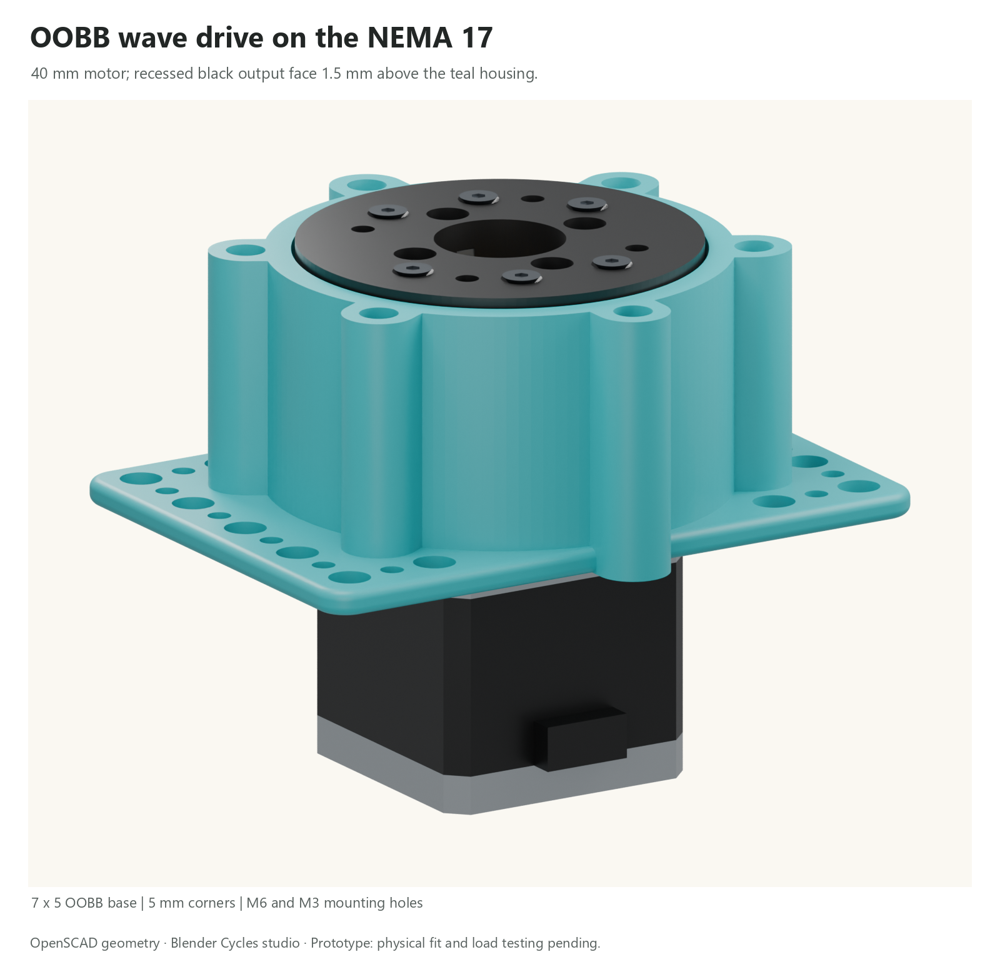

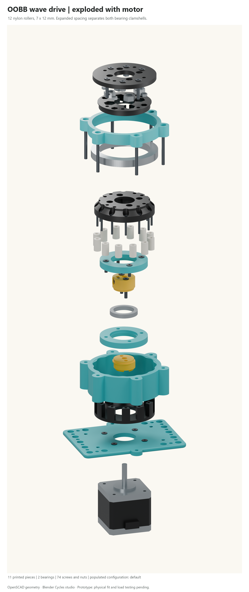

## Hardware

Quantities below are for the short-shaft assembly. The extended option replaces its two eccentric joiners with two M3 x 35 socket caps.

| Item | Quantity | Size / length |
| --- | ---: | --- |
| 6810 bearing | 1 | 50 x 65 x 7 mm |
| 6704 bearing | 1 | 20 x 27 x 4 mm |
| Nylon spacer roller | 12 | 7 OD x 3.2 ID x 12 mm |
| Case socket cap screw | 6 | M3 x 35 mm |
| Motor countersunk screw | 4 | M3 x 8 mm |
| Output countersunk screw | 4 | M3 x 20 mm |
| Output sandwich countersunk screw | 2 | M3 x 10 mm |
| Wave clamshell countersunk screw | 4 | M3 x 12 mm |
| Cage tooth countersunk screw | 12 | M2 x 20 mm |
| Eccentric countersunk screw | 2 | M3 x 20 mm |
| Shaft clamp countersunk screw | 1 | M3 x 8 mm |
| M3 hex nut | 23 |  |
| M6 hex nut | 4 |  |
| M2 hex nut | 12 |  |

## Verification

See mesh_validation.json and the reports in render/ for the checks actually performed. This single-bank design is not counterbalanced. Printed fit, clamp grip, wear, backlash, motor bearing loads and operating speed/torque still need physical testing.


## Assembly instructions

AI-generated images and instructions. Errors possible.

[Open the browser instructions](https://oomlout.github.io/oomlout_oobb_part_motor_gearbox_wave_drive_version_5/) · [Print the booklet](parts/oobb_part_motor_gearbox_wave_drive_version_5_12_to_1_reduction/assembly/assembly_instructions.pdf)

The diagrams show the short eccentric. For the extended option, place the lifter on the standard upper collar and use two M3 x 35 socket caps at the eccentric closing step. Tighten the upper shaft clamp before installing the outer case. Prepare the complete output sandwich before installing it.

## 01. Mount the motor and capture the case nuts

Load six M3 nuts from below the plate. Seat the plate on the motor pilot and install four M3 x 8 countersunk screws with heads 0.5 mm proud of its top face.

[](parts/oobb_part_motor_gearbox_wave_drive_version_5_12_to_1_reduction/assembly/cards/step_01.png)

## 02. Fit the cage with its captive nuts

Seat twelve M2 nuts underneath the lower cage, then lower the cage teeth upward onto the plate.

[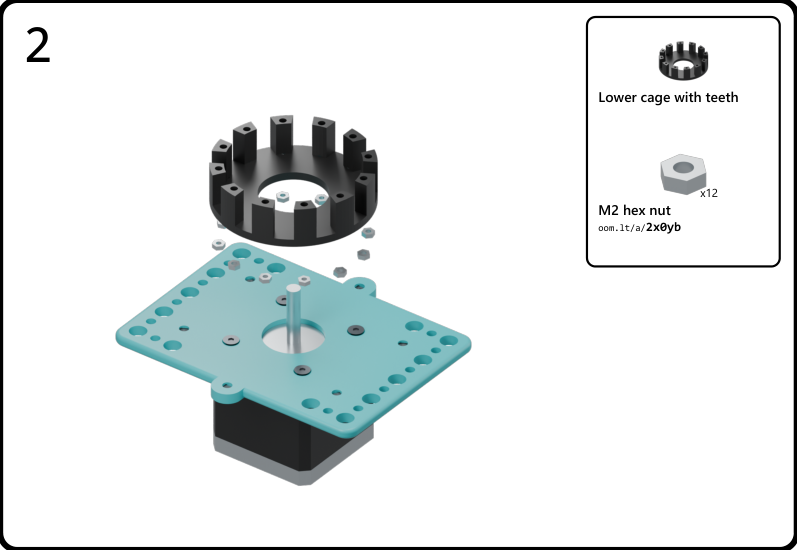](parts/oobb_part_motor_gearbox_wave_drive_version_5_12_to_1_reduction/assembly/cards/step_02.png)

## 03. Prepare and fit the lower eccentric

Load two M3 joint nuts from below. Slide the lower eccentric onto the motor shaft with its bearing journal upward. Locate the small semicircular mark on the edge of the lower collar.

[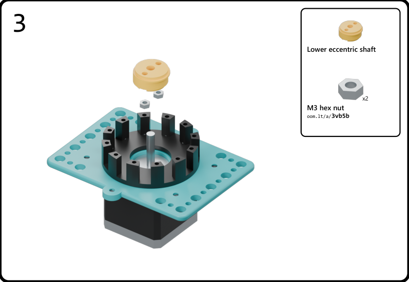](parts/oobb_part_motor_gearbox_wave_drive_version_5_12_to_1_reduction/assembly/cards/step_03.png)

## 04. Fit the lower wave half and 6704

Seat four M3 nuts underneath the lower clamshell. Lower it around the eccentric journal and seat the 6704 bearing squarely in its recess.

[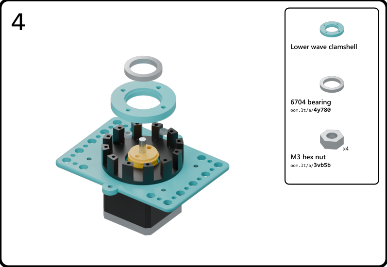](parts/oobb_part_motor_gearbox_wave_drive_version_5_12_to_1_reduction/assembly/cards/step_04.png)

## 05. Close the eccentric shaft

Load the radial M3 nut from the top of the upper eccentric and start its M3 x 8 clamp screw. Align the semicircular edge marks at the middle of the bearing. Tighten the two M3 x 20 countersunk joiners, then tighten the upper shaft clamp before fitting the outer case.

[](parts/oobb_part_motor_gearbox_wave_drive_version_5_12_to_1_reduction/assembly/cards/step_05.png)

## 06. Close the wave clamshell

Fit the upper wave half around the 6704 bearing. Tighten four M3 x 12 countersunk screws into the lower nuts.

[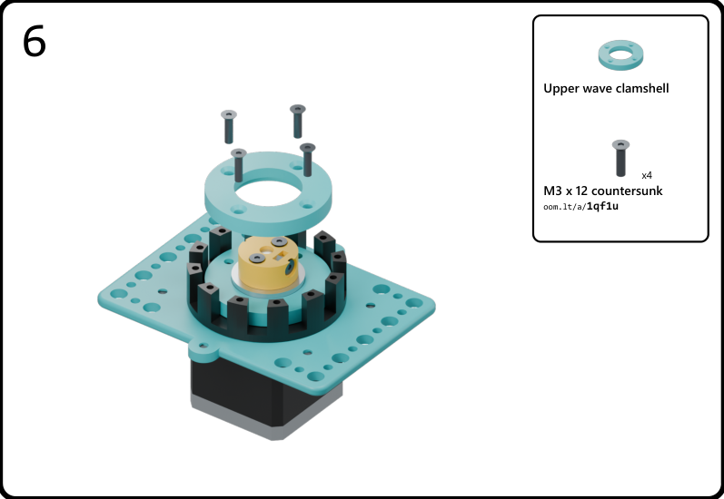](parts/oobb_part_motor_gearbox_wave_drive_version_5_12_to_1_reduction/assembly/cards/step_06.png)

## 07. Lower the fixed ring

Confirm the upper shaft clamp is tight, then lower the fixed ring around the cage and align all six fins with the base.

[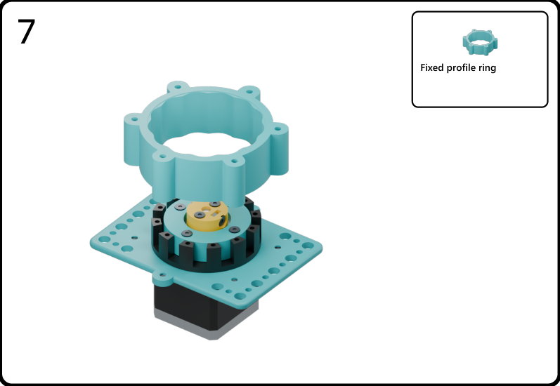](parts/oobb_part_motor_gearbox_wave_drive_version_5_12_to_1_reduction/assembly/cards/step_07.png)

## 08. Insert twelve rollers

At input angle zero, insert one 7 mm OD x 12 mm nylon spacer in each cage slot.

[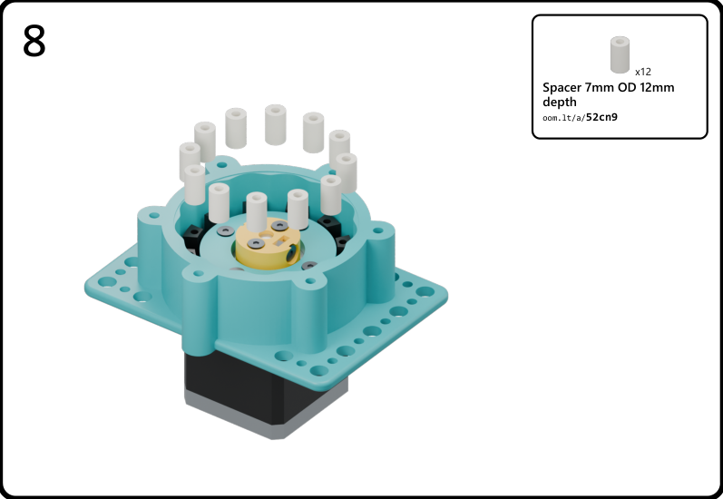](parts/oobb_part_motor_gearbox_wave_drive_version_5_12_to_1_reduction/assembly/cards/step_08.png)

## 09. Fit and fasten the upper cage

Load four M3 output nuts underneath the upper cage, then lower it over the teeth. Install all twelve M2 x 20 countersunk screws through the disc into the lower cage nuts.

[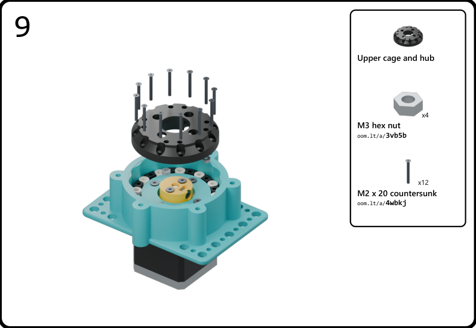](parts/oobb_part_motor_gearbox_wave_drive_version_5_12_to_1_reduction/assembly/cards/step_09.png)

## 10. Fit the output bearing and close the case

Seat the 6810 over the upper cage hub. Lower the housing over the bearing outer race. Insert six M3 x 35 socket caps from the top and tighten into the captive base nuts.

[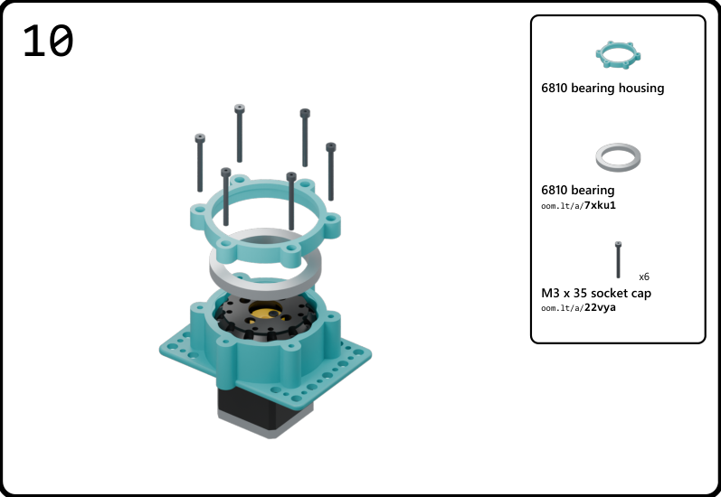](parts/oobb_part_motor_gearbox_wave_drive_version_5_12_to_1_reduction/assembly/cards/step_10.png)

## 11. Preassemble the output plate

Load 4 M6 and 4 M3 attachment nuts into the carrier and two M3 sandwich nuts from underneath. Fit the flat cover and tighten two M3 x 10 countersunk screws. The plate is now clamped as a separate assembly; its viewing hole and bolt-clearance holes stay open.

[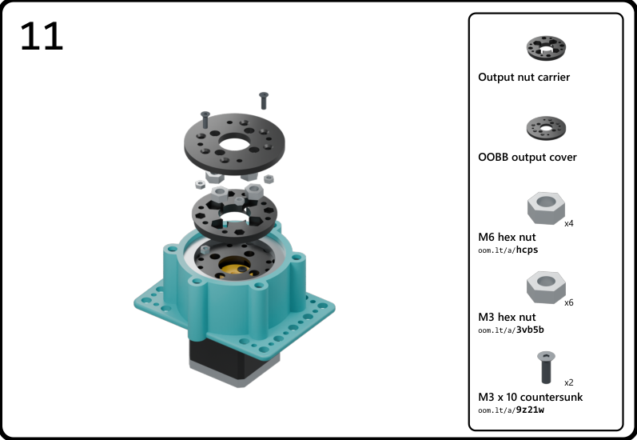](parts/oobb_part_motor_gearbox_wave_drive_version_5_12_to_1_reduction/assembly/cards/step_11.png)

## 12. Close the output face

Lower the preassembled output plate over the bearing and fasten it to the cage with four M3 x 20 countersunk screws. Keep the separate short sandwich screws tight. With power disconnected, hand-turn the input 12 times for one reverse output turn and observe the shaft through the 20 mm opening.

[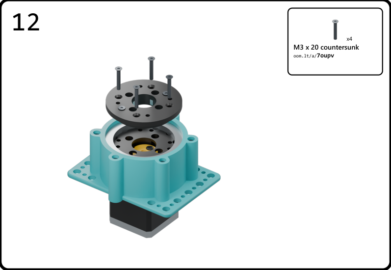](parts/oobb_part_motor_gearbox_wave_drive_version_5_12_to_1_reduction/assembly/cards/step_12.png)

M3 payload bolt projection below the output face: 6.40 to 22.00 mm. Check the actual print before fitting longer bolts.
