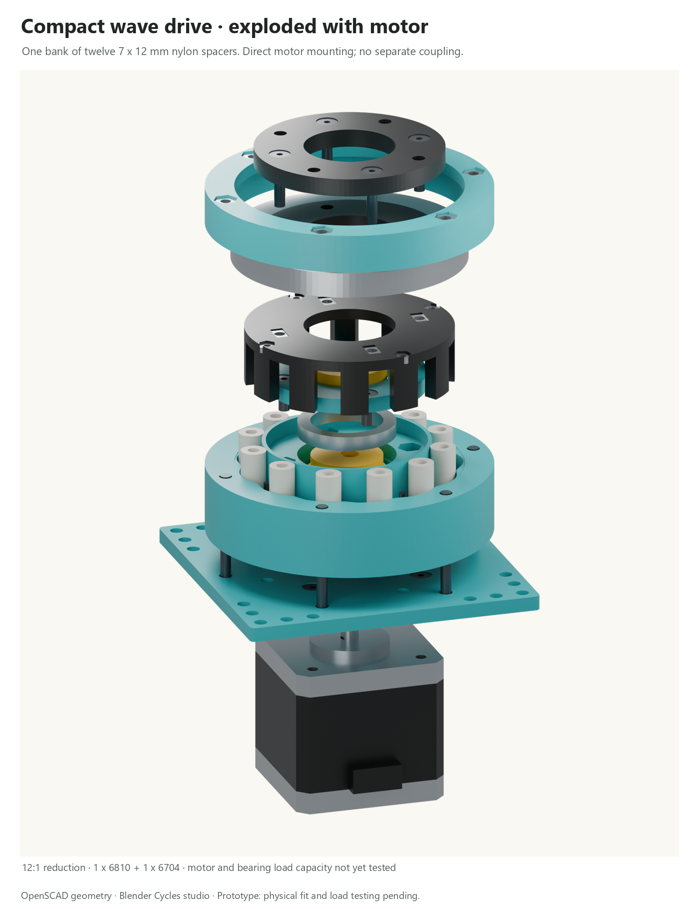

# Assembly - 12:1 wave drive

Dimensions in millimetres. Exploded spacing is illustrative.

1. Print the fit coupons. Check the 6810 seat, 6704 seat, motor D shaft, roller windows and OOBB nut pockets before the full build.

2. Mount the 40 mm NEMA 17 to the 6 x 6 OOBB plate with four M3 x 6 socket caps. Confirm 5.2 mm engagement fits the actual motor threads.

3. Preload the 4 M2 x 16 cage screws into the lower cap before fitting it around the shaft. Align their heads with the hex-key access holes in the motor plate.

4. Load the eccentric nut and fit the eccentric at Z=4.3 mm above the motor face. Tighten its M3 x 8 grub onto the shaft flat while the ring and rollers are absent.

5. Load four M3 nuts in the wave wheel, seat the 6704, and lower the wheel over the eccentric journal. Fit the upper eccentric collar and tighten its grub onto the flat with the intended bearing clearance.

6. Close the wave bearing cap with four M3 x 6 socket caps. Lower the fixed ring over the mechanism and align the housing holes.

7. At input angle zero, the eccentric points along +X. Insert all 12 nylon spacers axially, then lower the cage over them with its fingers downward. Preload its output nuts and fit the cage nuts in their top pockets.

8. Tighten the cage screws through the motor-plate access holes with an L hex key. Keep the key clear of the motor cable/connector.

9. Load the five M6 output nuts into the output hub and place the hub above the cage. Its central blind recess clears the motor shaft tip by 0.5 mm. Fit the single 6810 around the hub.

10. Fit the upper bearing housing with its mouth downward. Install the 6 M3 x 30 case caps and nuts. The fixed ring and upper housing retain the bearing outer race.

11. Fit the full-face output plate and its four M3 x 16 socket caps. Its five M6 attachment holes lie on a 15 mm OOBB grid; the corner M3 holes retain the plate. Use the generated attachment-depth limits when choosing payload bolts.

12. Turn the input slowly by hand and check one reverse output turn per 12 input turns. Physical fit, motor bearing loads, vibration and printed strength remain untested.

Payload bolt projection below output face: 12.90 to 14.90 mm.

