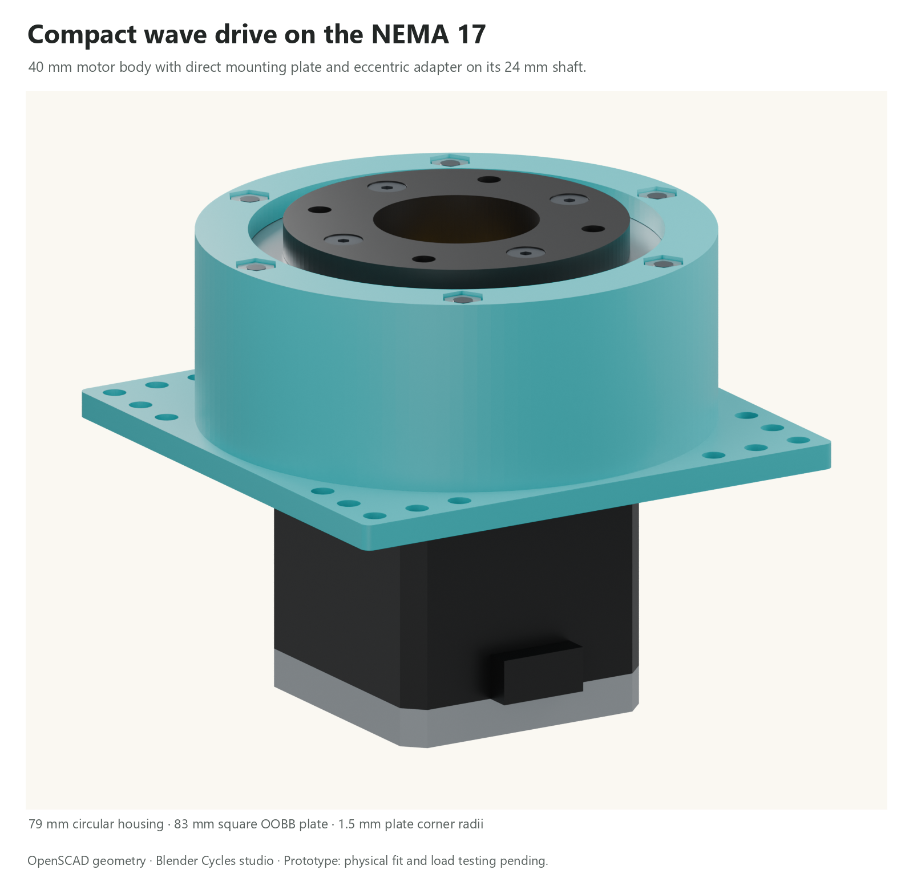
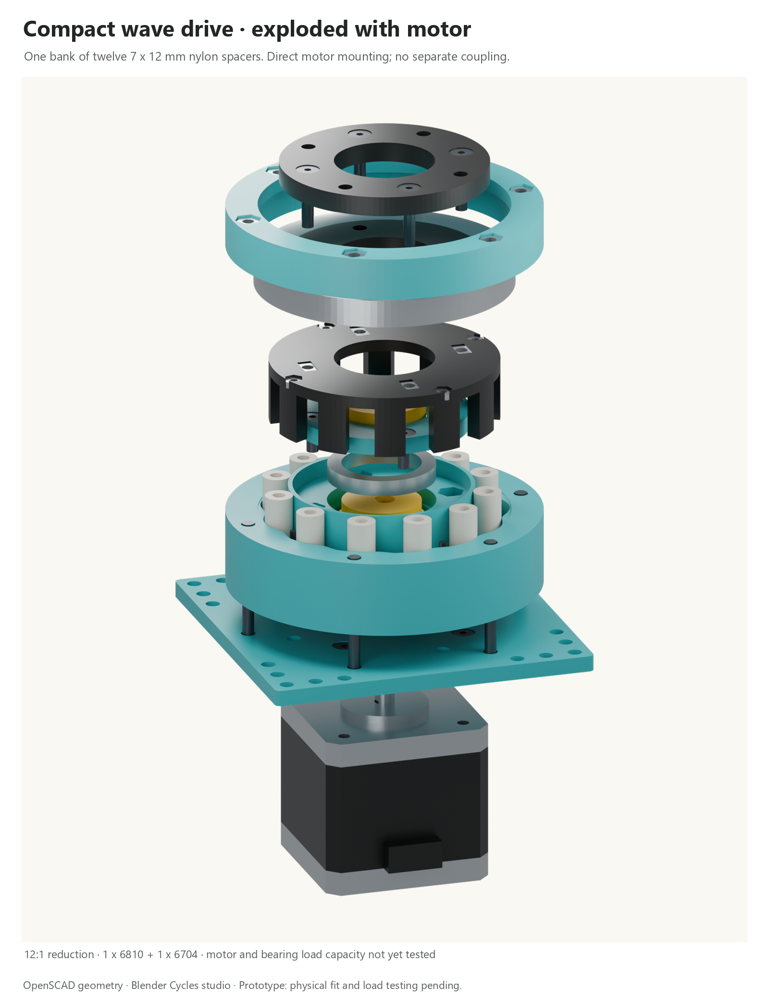

# 12:1 OOBB roller wave drive

Generated by working_oomp_populate -> working_oomp -> working_scad. Edit the populated configuration and rebuild; no AI or manual generated-file edits are required.

One bank of 12 nylon spacers, 7 mm OD x 12 mm long. Output speed is -1/12 of input speed. One 6810 supports the output; one 6704 supports the eccentric wave wheel.

Circular body: 79 mm OD. Base: 6 x 6 OOBB units (89 x 89 mm), 4 mm deep. Corner and upper/lower edge radii: 1.5 / 1.5 mm.

Full output face: 65 mm OD, with five M6 attachment holes on the 15 mm OOBB grid. Four corner M3 holes retain the plate. The input terminates in a blind pocket; it does not project through the output face.

Gearbox height above motor face: 39.9 mm. Reference motor body: 40 mm, shaft: 24 x 5 mm with 0.5 mm D flat.

Print one of each named part (11 instances), or the 2 print-bed layouts. Do not print both sets. Nylon rollers, bearings, motor and fasteners are purchased items. Fit coupons are optional.

Open motor_fit.scad, exploded_motor.scad or animation.scad. Blender views and the editable scene are in render/images and render/scenes. Read [ASSEMBLY.md](ASSEMBLY.md) before assembly.

## Hardware

| Item | Quantity | Size / length |
| --- | ---: | --- |
| 6810 bearing | 1 | 50 x 65 x 7 mm |
| 6704 bearing | 1 | 20 x 27 x 4 mm |
| Nylon spacer roller | 12 | 7 OD x 3.2 ID x 12 mm |
| Case socket cap screw | 6 | M3 x 30 mm |
| Motor socket cap screw | 4 | M3 x 6 mm |
| Output socket cap screw | 4 | M3 x 16 mm |
| Wave cap socket cap screw | 4 | M3 x 6 mm |
| Cage socket cap screw | 4 | M2 x 16 mm |
| M3 x 8 grub screw | 2 |  x 8 mm |
| M3 hex nut | 16 |  |
| M6 hex nut | 5 |  |
| M2 hex nut | 4 |  |

Payload bolts are not included: select them for the attached part thickness and the depth limits below.

## Output attachment

Bolt projection below the output face must be between 12.90 and 14.90 mm for approximately 3 to 5 mm engagement in the captive M6 nuts. Longer bolts can bottom out or damage the blind pocket. These limits are for the generated geometry; verify actual printed fits.

The motor shaft tip is at Z=24 mm; the blind roof is 0.5 mm above it. There is no upper input bearing, shaft extension or coupling through the output plate.

## Verification

See mesh_validation.json for printable solids and native interference checks, and render/validation.json, render/fastener_validation.json and render/motor_fit.json for assembly registration and hardware fits. Reports describe only checks actually executed.

This single-bank design is not counterbalanced. Printed fit, fastener-seat strength, actual motor bearing loads, wear, heat, backlash and operating speed/torque have not been physically tested. The motor drawing specifies an envelope, not a bearing load rating.
