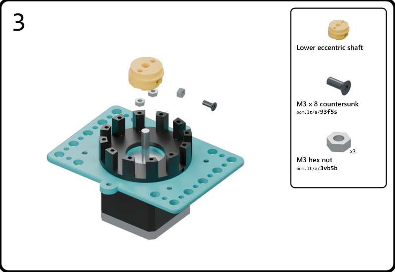
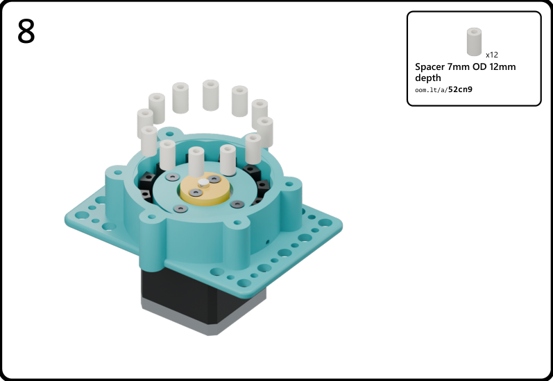
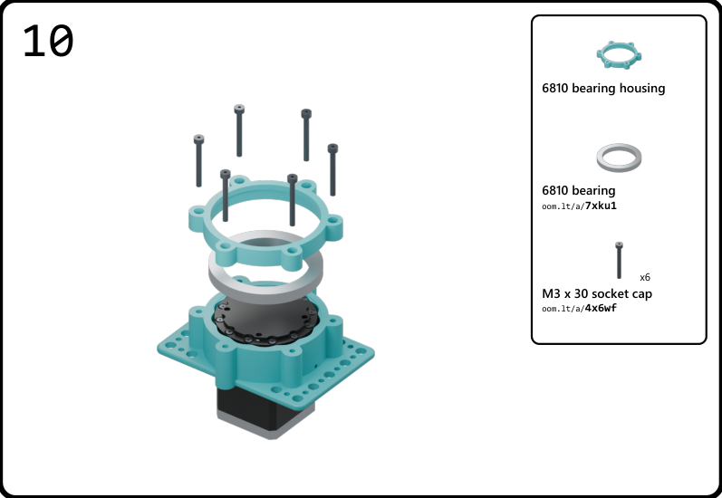
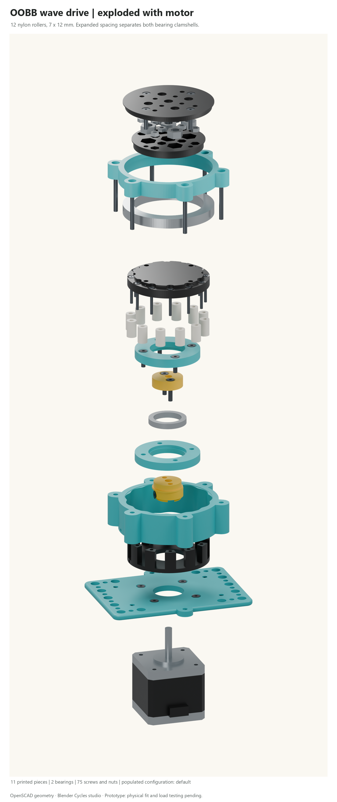

# Assembly - 12:1 wave drive

Dimensions in millimetres. Exploded spacing is illustrative.

AI-generated images and instructions. Errors possible.
[Open the single-step HTML viewer](assembly/assembly_instructions.html). The file includes its images and works offline. Use arrow keys, swipe, the step selector or the full-screen button.

[Print the A4 instructions](assembly/assembly_instructions.pdf) - booklet in reading order, with four numbered panels per landscape instruction page. Cover and project details precede the steps; a full-page finished view follows the steps; signature padding keeps the boxed printed and hardware inventories immediately before the back cover.

Each parts box lists the new parts for that panel, with the image followed by a compact quantity such as x2. Hardware entries have oom.lt/a/ catalogue links; printed entries have names and no codes. The [full inventory](assembly/parts.csv) distinguishes catalogue and project-local identities; generating a local code does not register a public redirect.

Every panel retains the complete assembly-so-far in its normal materials. Nuts are shown below or above the receiving part in the same panel; increased separation exposes nuts underneath their receiving parts, without arrows. Hardware threads and bearing internals are simplified in the CAD illustration. Printed panels contain only numbers, diagrams and part details; the companion notes retain the written sequence.

Before assembly, clean bridge material and check the fit coupons. Print the lower cage teeth upward and the upper cage broad face down, hub upward. Inspect the upper cage's bridged central roof. Countersunk screw lengths include the head; socket-cap lengths are measured below the head.

## 01. Mount the motor and capture the case nuts

Load six M3 nuts from below the plate. Seat the plate on the motor pilot and install four M3 x 8 countersunk screws flush with its top face.

## 02. Fit the cage with its captive nuts

Seat twelve M2 nuts underneath the lower cage, then lower the cage teeth upward onto the plate. Align the service hole with the shaft clamp (+X).

## 03. Prepare and fit the lower eccentric

Load two M3 joint nuts from below and one radial M3 clamp nut. Start the M3 x 8 countersunk screw, leaving the bore clear. Slide onto the motor shaft and snug the clamp through the cage port.

## 04. Fit the lower wave half and 6704

Seat four M3 nuts underneath the lower clamshell. Lower it around the eccentric journal and seat the 6704 bearing squarely in its recess.

## 05. Close the eccentric shaft

Fit the upper eccentric collar and tighten two M3 x 16 countersunk screws into the lower nuts.

## 06. Close the wave clamshell

Fit the upper wave half around the 6704 bearing. Tighten four M3 x 12 countersunk screws into the lower nuts.

## 07. Lower the fixed ring

Lower the fixed ring around the cage. Align all six fins with the base and the service hole with the cage port (+X).

## 08. Insert twelve rollers

At input angle zero, insert one 7 mm OD x 12 mm nylon spacer in each cage slot.

## 09. Fit and fasten the upper cage

Load four M3 output nuts underneath the upper cage, then lower it over the teeth. Install all twelve M2 x 20 countersunk screws through the disc into the lower cage nuts.

## 10. Fit the output bearing and close the case

Seat the 6810 over the upper cage hub. Lower the housing over the bearing outer race. Insert six M3 x 30 socket caps from the top and tighten into the captive base nuts.

## 11. Load and fit the output nut carrier

Fit five M6 nuts and eight M3 nuts in the carrier's upward-facing pockets. Lower the loaded carrier into the 6810 bore, keeping the four off-grid fixing holes clear.

## 12. Close the output face

Fit the output cover and tighten four M3 x 12 socket caps in the off-grid fixing holes. Align the service ports to adjust the shaft clamp with a slim 2 mm hex driver. Withdraw it, disconnect power and hand-turn the input 12 times for one reverse output turn.

Payload bolt projection below output face: M6 7.40 to 9.40 mm; M3 6.40 to 6.90 mm.

