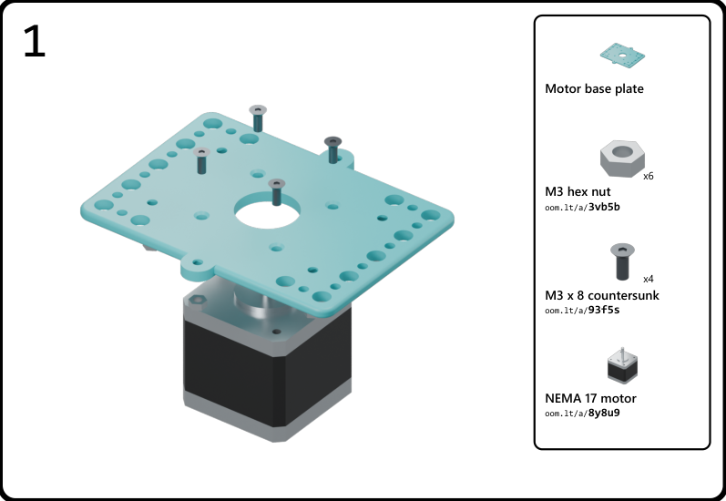
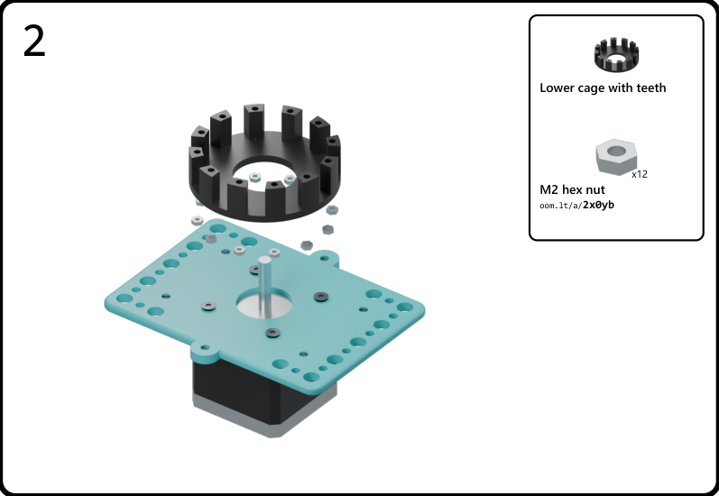
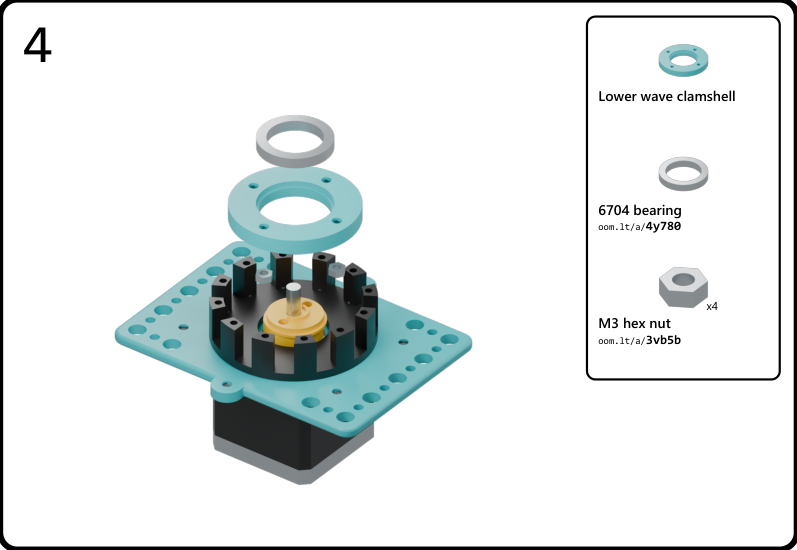
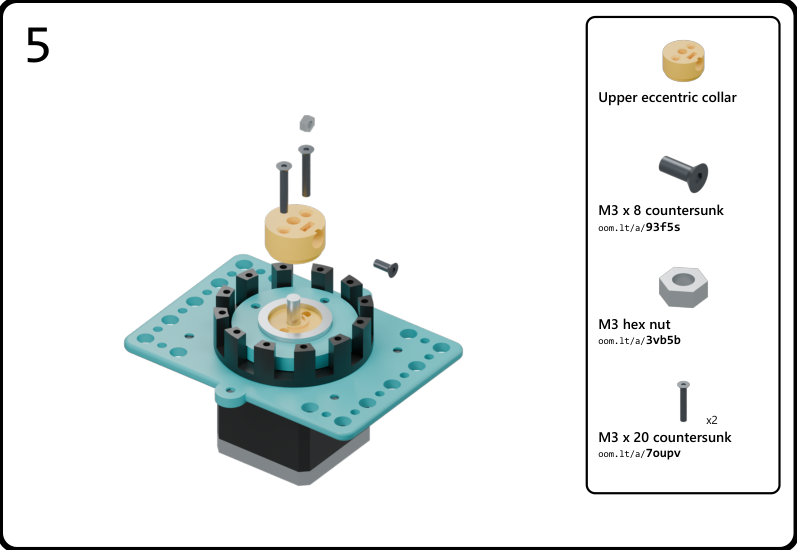
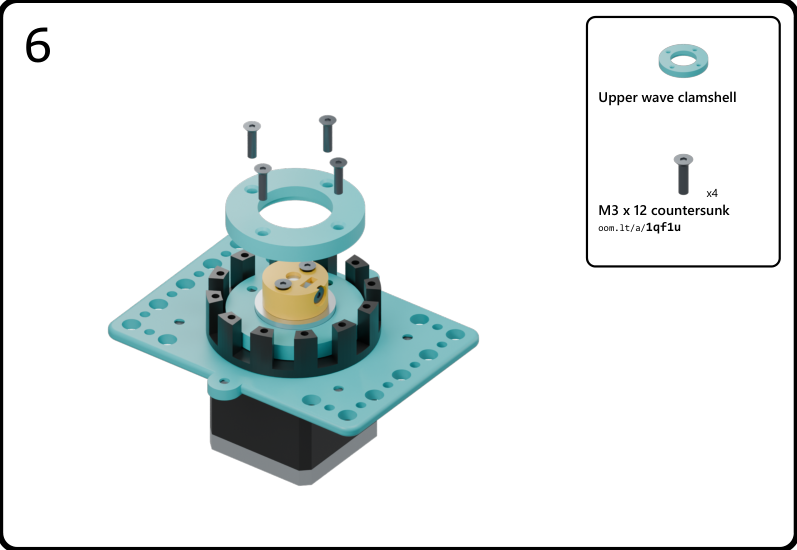
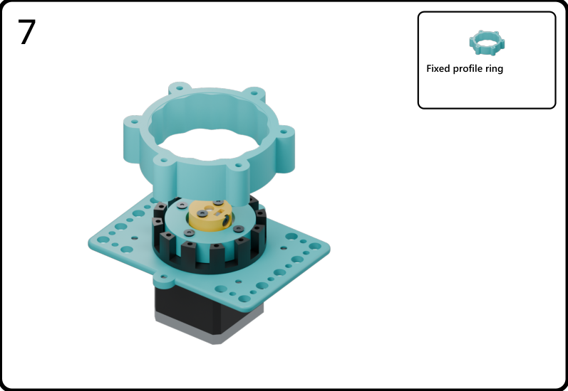
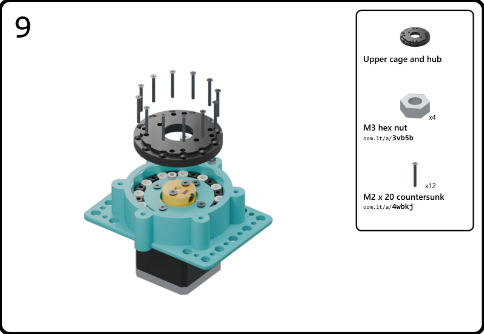
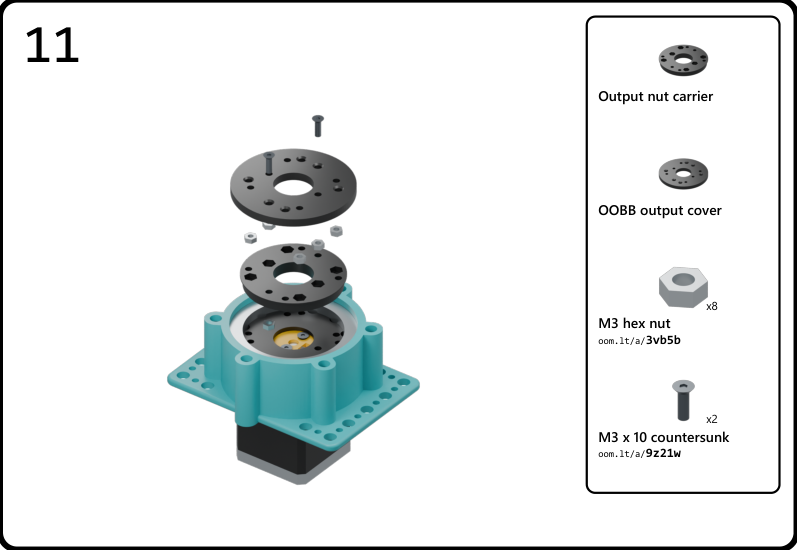
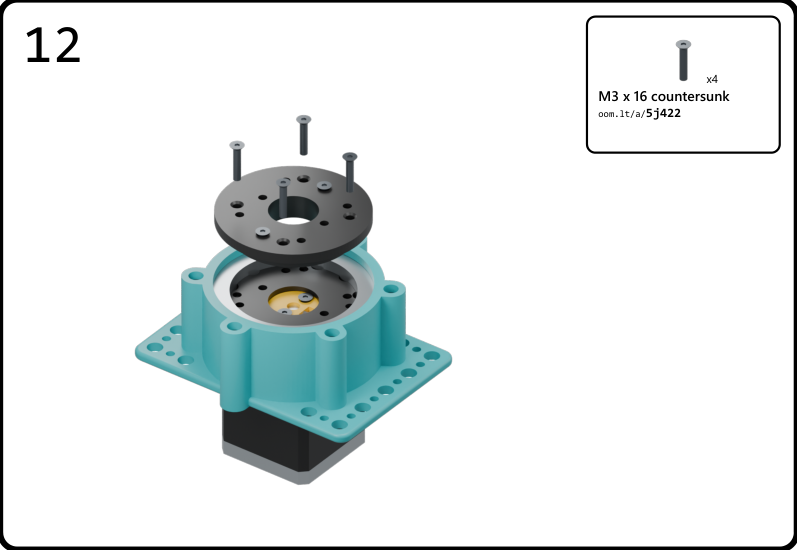

# Assembly - 12:1 wave drive

AI-generated images and instructions. Errors possible.

[Open the browser instructions](https://oomlout.github.io/oomlout_oobb_part_motor_gearbox_wave_drive_version_5/) · [Print the booklet](assembly/assembly_instructions.pdf)

The diagrams show the short eccentric. For the extended option, substitute the extended upper piece and two M3 x 30 socket caps at the eccentric closing step. Tighten the upper shaft clamp before installing the outer case. Prepare the complete output sandwich before installing it.

## 01. Mount the motor and capture the case nuts

Load six M3 nuts from below the plate. Seat the plate on the motor pilot and install four M3 x 8 countersunk screws with heads 1 mm proud of its top face.

## 02. Fit the cage with its captive nuts

Seat twelve M2 nuts underneath the lower cage, then lower the cage teeth upward onto the plate.

## 03. Prepare and fit the lower eccentric

Load two M3 joint nuts from below. Slide the lower eccentric onto the motor shaft with its semicircular alignment tongue upward.

## 04. Fit the lower wave half and 6704

Seat four M3 nuts underneath the lower clamshell. Lower it around the eccentric journal and seat the 6704 bearing squarely in its recess.

## 05. Close the eccentric shaft

Load the radial M3 nut from the top of the upper eccentric and start its M3 x 8 clamp screw. Match the semicircular key and recess at the middle of the bearing. Tighten the two M3 x 20 countersunk joiners, then tighten the upper shaft clamp before fitting the outer case.

## 06. Close the wave clamshell

Fit the upper wave half around the 6704 bearing. Tighten four M3 x 12 countersunk screws into the lower nuts.

## 07. Lower the fixed ring

Confirm the upper shaft clamp is tight, then lower the fixed ring around the cage and align all six fins with the base.

## 08. Insert twelve rollers

At input angle zero, insert one 7 mm OD x 12 mm nylon spacer in each cage slot.

## 09. Fit and fasten the upper cage

Load four M3 output nuts underneath the upper cage, then lower it over the teeth. Install all twelve M2 x 20 countersunk screws through the disc into the lower cage nuts.

## 10. Fit the output bearing and close the case

Seat the 6810 over the upper cage hub. Lower the housing over the bearing outer race. Insert six M3 x 30 socket caps from the top and tighten into the captive base nuts.

## 11. Preassemble the output plate

Load 6 M3 attachment nuts into the carrier and two M3 sandwich nuts from underneath. Fit the flat cover and tighten two M3 x 10 countersunk screws. The plate is now clamped as a separate assembly; its viewing hole and bolt-clearance holes stay open.

## 12. Close the output face

Lower the preassembled output plate over the bearing and fasten it to the cage with four M3 x 16 countersunk screws. Keep the separate short sandwich screws tight. With power disconnected, hand-turn the input 12 times for one reverse output turn and observe the shaft through the 20 mm opening.

M3 payload bolt projection below the output face: 6.40 to 17.20 mm. Check the actual print before fitting longer bolts.
