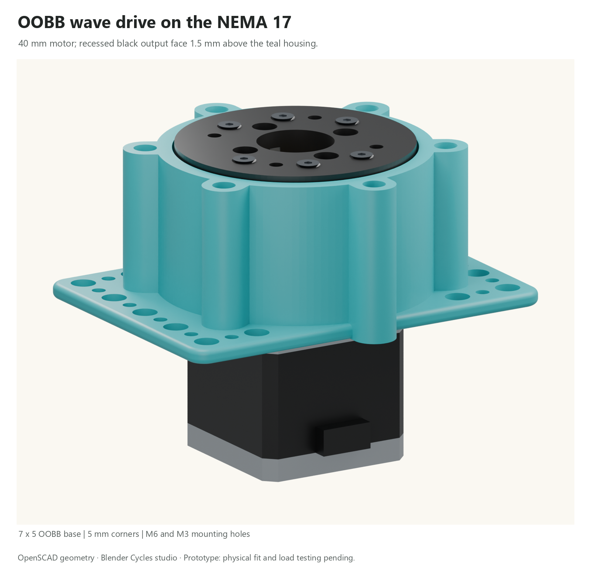
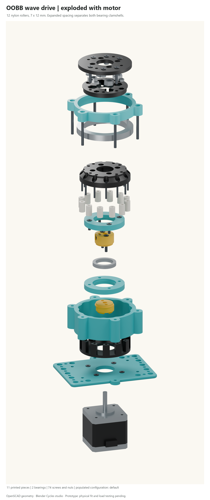

# 12:1 OOBB roller wave drive

One bank of 12 nylon spacers, 7 mm OD x 12 mm deep. Output speed is -1/12 of input speed. One 6810 supports the output; one 6704 supports the wave wheel.

[Assembly instructions in your browser](https://oomlout.github.io/oomlout_oobb_part_motor_gearbox_wave_drive_version_5/) · [PDF booklet](assembly/assembly_instructions.pdf) · [Written sequence](ASSEMBLY.md)

The 7 x 5 OOBB base has M6 and M3 holes, 5 mm corner radii and 1.5 mm rounded edges. The main housing is 71.2 mm OD. Reference motor: 40 mm NEMA 17 body, plain round 5 mm shaft, 24 mm long.

## Wiggle shaft

Both eccentric pieces split at Z=13.3 mm, the centre of the 6704 bearing. Align the small semicircular edge marks on the two collars.

Load the upper radial M3 nut from the top and tighten the M3 x 8 countersunk clamp onto the motor shaft before fitting the fixed ring and upper cage. The case and lower cage have no adjustment access holes. Two M3 x 20 countersunk screws join the short eccentric to its lower captive nuts.

Optional extended version: [motor_eccentric_cap_extended.stl](motor_eccentric_cap_extended.stl) sits on the standard upper collar. Its 19.2 mm stem reaches the output face at Z=42.4 mm, with clearance through the 20 mm viewing hole. Use two M3 x 35 socket caps instead of the short version's countersunk joiners. Reuse the lower piece and captive nuts. See [assembly_extended.scad](assembly_extended.scad). Fit the shaft clamp nut before adding the lifter.

## Output plate

The flat-sided output face is 61.8 mm OD with a 20 mm central viewing hole. It has no overhanging outer lip; the bearing remains visible. The output face stays 1.5 mm above the housing.

Preassemble the carrier and cover with two M3 x 10 countersunk screws and separate captive M3 nuts. Then attach the complete sandwich to the cage with four M3 x 20 countersunk screws. The short screws stay in place while installing or removing the plate.

The carrier holds 4 M3 attachment nuts on the OOBB half-grid. The carrier also holds 4 M6 nuts with their flats toward the centre. M6 holes remain in the base. M3 centres in mm: [[-15.0, -15.0], [-15.0, 15.0], [15.0, -15.0], [15.0, 15.0]]. M6 centres in mm: [[15.0, 0], [-15.0, 0], [0, 15.0], [0, -15.0]].

Clearance holes continue below the attachment nuts through the carrier and cage. M3 payload bolt projection below the output face may be 6.40 to 22.00 mm, allowing at least 2 mm thread engagement while stopping above the moving wave screws. Measure the actual printed assembly; longer bolts must not reach the moving parts.

## Printing and assembly

Print the 11 required gearbox pieces. The combined 3dpr file and print beds also include 12 optional printable spacers and the optional separate shaft lifter. Fit the lifter for the tall option. Choose either purchased nylon spacers or printed spacers. Bearings, motor and fasteners are purchased items.

Print the lower cage with its teeth upward and the upper cage with its hub face on the bed and its 45-degree shoulder widening upward. Inspect bridge material, bearing seats and the orientation marks before assembly. The upper and lower cage have annular clearances for the raised M3 wave and motor screw heads.

M3 axial countersunk heads sit 0.5 mm proud; do not force them flush. M2 cage screws stay seated, with 1.6 mm nominal tip clearance. The radial shaft clamp tightens onto the shaft. Motor screws retain 3.5 mm nominal thread engagement. Socket-cap lengths exclude the head; countersunk lengths include it.

## Hardware

Quantities below are for the short-shaft assembly. The extended option replaces its two eccentric joiners with two M3 x 35 socket caps.

| Item | Quantity | Size / length |
| --- | ---: | --- |
| 6810 bearing | 1 | 50 x 65 x 7 mm |
| 6704 bearing | 1 | 20 x 27 x 4 mm |
| Nylon spacer roller | 12 | 7 OD x 3.2 ID x 12 mm |
| Case socket cap screw | 6 | M3 x 35 mm |
| Motor countersunk screw | 4 | M3 x 8 mm |
| Output countersunk screw | 4 | M3 x 20 mm |
| Output sandwich countersunk screw | 2 | M3 x 10 mm |
| Wave clamshell countersunk screw | 4 | M3 x 12 mm |
| Cage tooth countersunk screw | 12 | M2 x 20 mm |
| Eccentric countersunk screw | 2 | M3 x 20 mm |
| Shaft clamp countersunk screw | 1 | M3 x 8 mm |
| M3 hex nut | 23 |  |
| M6 hex nut | 4 |  |
| M2 hex nut | 12 |  |

## Verification

See mesh_validation.json and the reports in render/ for the checks actually performed. This single-bank design is not counterbalanced. Printed fit, clamp grip, wear, backlash, motor bearing loads and operating speed/torque still need physical testing.
